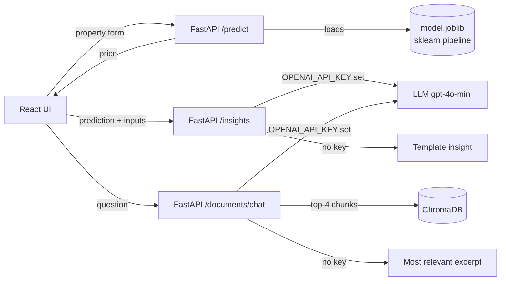

# AI Real Estate Advisor


An AI assistant for Indian home buyers and investors. It does three things:

1. **Estimates a fair price** for a property with a machine-learning model.
2. **Explains that price** in plain language with an LLM.
3. **Answers questions from property documents** (sale agreements, society rules, legal checklists,
   locality guides), using retrieval-augmented generation (RAG) with the source shown.

It also includes market insights by city and an EMI / home-loan calculator. Every AI feature has a
fallback, so the whole app runs **without a paid API key**.

## Contents

- [Why AI for real estate?](#why-ai-for-real-estate)
- [Features](#features)
- [How it works](#how-it-works)
- [Model results](#model-results)
- [Tech stack](#tech-stack)
- [Project structure](#project-structure)
- [Getting started](#getting-started)
- [API overview](#api-overview)
- [Testing](#testing)
- [Deployment](#deployment)
- [Limitations and roadmap](#limitations-and-roadmap)

## Why AI for real estate?

Brokers and property portals already exist, but they leave real gaps for a buyer:

| Today | The gap | What this project adds |
|---|---|---|
| A broker estimates price from experience | Estimates vary, and advice can be biased by commission | A consistent, data-driven estimate that weighs 9 factors together, in seconds |
| Portals filter listings by price and BHK | Filters show listings; they don't say whether a price is fair | A fair-price estimate plus an explanation of what drives it |
| Buyers read 40-page agreements and brochures themselves | Legal language, little time, important clauses get missed | Ask "What are the maintenance charges?" and get an answer from the document, with its source |
| Advice is available only during office hours | Questions come up at night and on weekends | Instant answers, any time |

**AI's role is to assist the advisor, not replace them.** The system handles the data-heavy,
repetitive and document-reading work; people handle negotiation, site visits and the final legal
decision. Prompts explicitly avoid guarantees and legal or financial advice.

## Features

| Tab | What it does |
|---|---|
| **Valuation** | Enter area, bedrooms, bathrooms, age, parking, amenities score, city, locality and furnishing; get a predicted price (₹ Lakh / Cr) and an AI-written insight |
| **Market Insights** | Average price by city and median price by furnishing type |
| **Financing** | EMI, total interest, down payment and total cost for a home loan |
| **History** | Valuations from the current session |
| **Documents** | Chat with indexed real-estate documents, or upload your own PDF / TXT / MD files |

Other highlights:
- A scikit-learn pipeline keeps preprocessing identical at training and prediction time.
- Model selection by 5-fold cross-validation (Random Forest vs Gradient Boosting).
- Pydantic validation on every request (for example, area must be 100–20,000 sq ft).
- Graceful degradation: local embeddings, template insights and excerpt answers when no LLM key is set.
  Responses say whether they came from the `llm` or a `template`.
- Re-uploading a document replaces its old chunks instead of duplicating them.

## How it works



**Valuation.** `StandardScaler` on numeric features (area, bedrooms, bathrooms, age, parking,
amenities) and `OneHotEncoder(handle_unknown="ignore")` on city, locality and furnishing, followed by
the model, all in one pipeline. An unseen locality therefore doesn't crash the API.

**RAG pipeline.**
1. *Ingest*: load PDF (`pypdf`), TXT or MD → split into 800-character chunks with 120-character overlap
   (recursive splitter: paragraph → line → sentence) → embed → store in ChromaDB with filename metadata.
2. *Embeddings*: OpenAI `text-embedding-3-small` if a key is set, otherwise the free local
   `sentence-transformers/all-MiniLM-L6-v2`.
3. *Answer*: embed the question → retrieve the 4 most similar chunks → `gpt-4o-mini` at temperature
   0.3 with a system prompt to answer **only from the given context** and to say so when the answer
   isn't there → return the answer and the source filenames.

**Guarding against hallucination:** the model sees only retrieved context, the prompt forbids guessing,
temperature is low, sources are shown, and an empty retrieval returns "not found" instead of an answer.

## Model results

From `app/model/metrics.json`:

| Model | 5-fold CV R² | |
|---|---|---|
| **Gradient Boosting** (selected) | **0.954 ± 0.004** | Test R² 0.951 · MAE ≈ ₹14.7 lakh · RMSE ≈ ₹20.6 lakh |
| Random Forest | 0.948 ± 0.004 | |

Training uses 3,200 rows and testing uses 800.

> **Important:** these scores are on a **synthetic** dataset (`src/generate_data.py`): 4,000 listings
> across 7 cities and 35 localities, with realistic relationships between price, location, area, age,
> amenities, furnishing and parking. The high R² shows the pipeline learns those relationships; it is
> **not** a claim of real-market accuracy. To train on real data, `src/prepare_real_data.py` converts
> the public Kaggle *Bengaluru House Price Data* into the same schema and logs every value it imputes.
> Expect lower accuracy on real data.

## Tech stack

| Layer | Tools |
|---|---|
| ML | Python, pandas, NumPy, scikit-learn, joblib |
| Backend | FastAPI, Pydantic, Uvicorn |
| GenAI / RAG | OpenAI API (`gpt-4o-mini`, `text-embedding-3-small`), LangChain, ChromaDB, sentence-transformers, pypdf |
| Frontend | React, TypeScript, Vite, Recharts |
| Quality & deploy | pytest, Render (backend), Vercel / Netlify (frontend) |

## Project structure

```
AI-Real-Estate-Advisor/
├── app/
│   ├── main.py              # FastAPI: /predict, /insights, /market/*, health
│   ├── rag.py               # /documents: list, upload, chat
│   ├── rag_common.py        # embeddings, Chroma store, chunking, grounded answer
│   ├── insights.py          # LLM insight with template fallback
│   ├── schemas.py           # Pydantic request/response models
│   └── model/               # model.joblib, metrics.json
├── src/
│   ├── generate_data.py     # synthetic Indian housing dataset
│   ├── prepare_real_data.py # convert Kaggle Bengaluru data to this schema
│   ├── preprocessing.py     # shared feature pipeline
│   ├── train.py             # CV model selection + training
│   └── ingest_documents.py  # index data/documents into ChromaDB
├── data/
│   ├── housing_data.csv
│   └── documents/           # sample RAG corpus (brochure, legal checklist, locality guides, agreement)
├── frontend/src/tabs/       # Valuation, MarketInsights, Financing, History, Documents
├── tests/                   # pipeline, API and RAG tests
├── docs/DEPLOYMENT.md
└── render.yaml, Procfile, runtime.txt
```

## Getting started

**1. Backend**
```bash
python -m venv venv
venv\Scripts\activate              # Windows   (macOS/Linux: source venv/bin/activate)
# CPU-only torch first, for local embeddings:
pip install torch==2.6.0 --index-url https://download.pytorch.org/whl/cpu
pip install -r requirements.txt
copy .env.example .env             # optional: add OPENAI_API_KEY
```

**2. Data and model**
```bash
python src/generate_data.py        # writes data/housing_data.csv
python src/train.py                # writes app/model/model.joblib and metrics.json
python src/ingest_documents.py     # indexes data/documents/ into ChromaDB
```

**3. Run the API**
```bash
uvicorn app.main:app --reload
```
Interactive docs: http://localhost:8000/docs

**4. Frontend**
```bash
cd frontend
npm install
npm run dev
```
Set `VITE_API_BASE_URL` if the backend isn't on `http://localhost:8000`.

**Example.** A 1,200 sq ft, 2BHK, 2-bath, 5-year-old semi-furnished flat in Kothrud, Pune, with 1 parking
spot and amenities 6/10, gets a predicted price of about ₹95.8 lakh, plus an insight on price per sq ft
and what to verify before buying.

## API overview

| Endpoint | Purpose |
|---|---|
| `POST /predict` | Price estimate from property details |
| `POST /insights` | Plain-language insight for a prediction (`source`: `llm` or `template`) |
| `GET /market/summary` | Listings count, medians, average price by city, price by furnishing |
| `GET /market/by-city/{city}` | Median price, price per sq ft and top locality for a city |
| `GET /documents` | Indexed documents and their chunk counts |
| `POST /documents/upload` | Index a PDF / TXT / MD file |
| `POST /documents/chat` | Ask a question; returns the answer and source filenames |
| `GET /health` | Service and model status |

## Testing

```bash
pytest -q
```
11 tests cover the ML pipeline, the API endpoints and the RAG feature, including the fallback path,
so the suite runs without a paid API key.

## Deployment

The backend goes to Render via `render.yaml` (the build trains the model and ingests the sample
documents). The frontend goes to Vercel or Netlify, with `VITE_API_BASE_URL` pointing at the backend.
See [`docs/DEPLOYMENT.md`](docs/DEPLOYMENT.md). Note: Render's free tier has an ephemeral disk, so
uploaded documents are lost on restart unless you add a persistent disk or cloud storage.

## Limitations and roadmap

- **Real data:** train on real transaction data, and report MAE in lakhs and prediction intervals.
- **Better features:** distance to metro, schools and offices; price per sq ft as the target.
- **RAG evaluation:** a golden question set to measure retrieval hit rate and answer faithfulness.
- **Security for production:** user authentication, restricted CORS, rate limiting on LLM endpoints,
  and upload size limits.
- **Documents:** OCR for scanned PDFs; Hindi and regional-language answers.
- **Features:** side-by-side comparison of two properties.

## Disclaimer

Price estimates and document answers are informational only and are not financial or legal advice.
Verify with recent local transactions and a qualified lawyer before buying.

## Author

**Rama Bharti** · [GitHub](https://github.com/ramabharti8) · [LinkedIn](https://linkedin.com/in/ramabharti)
