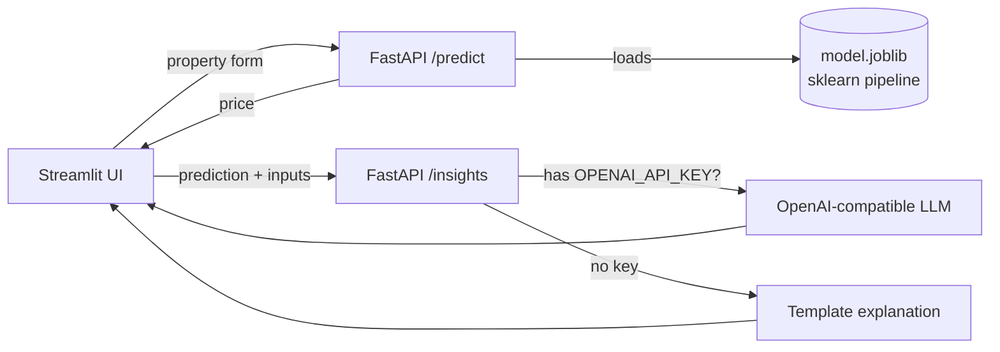

# AI Real Estate Advisor

## Overview
AI Real Estate Advisor is an end-to-end Machine Learning + Generative AI project that predicts Indian residential property prices, generates a natural-language investment insight for each prediction, and answers questions over real-estate documents via retrieval-augmented generation (RAG). It ships as two deployable services: a FastAPI backend (model serving + RAG) and a React (Vite + TypeScript) frontend.

## Problem Statement
Estimating the fair price of a property is challenging due to multiple influencing factors such as location, size, amenities, and market trends. Buyers and investors often lack accurate price estimation, data-driven insights, and clear investment guidance. This project addresses that with a regression model plus an LLM-generated explanation layer.

## System Workflow



## Features (Implemented)
- Synthetic but realistically-correlated Indian housing dataset generator (`src/generate_data.py`)
- Feature engineering + preprocessing pipeline (`src/preprocessing.py`): scaling for numeric features, one-hot encoding for categoricals
- Model training with candidate comparison via 5-fold CV — RandomForest vs GradientBoosting, best picked automatically (`src/train.py`)
- FastAPI backend with `/predict` and `/insights` endpoints, Pydantic request/response validation (`app/`)
- LLM-backed insight generation (OpenAI-compatible client) with a graceful template fallback when `OPENAI_API_KEY` is unset
- Document Q&A (RAG) over sample and user-uploaded real-estate documents using LangChain + ChromaDB, with a free local-embedding fallback (`sentence-transformers`) and a retrieved-excerpt fallback when no LLM key is set (`app/rag.py`, `app/rag_common.py`, `src/ingest_documents.py`)
- React (Vite + TypeScript) frontend: Valuation form + chart, Market Insights, Financing/EMI calculator, session History, and a Documents (RAG chat) tab (`frontend/`)
- Pytest suite covering the ML pipeline, the core API, and the RAG feature (`tests/`)
- Deploy-ready config for Render/Railway (backend)

## Tech Stack

**Core**: Python, Pandas, NumPy, Scikit-learn, Joblib
**Visualization**: Matplotlib (backend charts), Recharts (frontend charts)
**Backend**: FastAPI, Pydantic, Uvicorn
**Frontend**: React, TypeScript, Vite
**GenAI**: OpenAI-compatible chat completion API; LangChain + ChromaDB for RAG; sentence-transformers for zero-key local embeddings

## Project Structure

```
ai-real-estate-advisor/
├── data/                  housing_data.csv (synthetic, generated); documents/ (sample RAG corpus)
├── notebooks/             exploratory notebooks (optional, ad hoc)
├── src/                   generate_data.py, preprocessing.py, train.py, ingest_documents.py
├── app/                   main.py (FastAPI), schemas.py, insights.py, rag.py, rag_common.py, model/, vectorstore/ (gitignored)
├── frontend/              Vite + React + TypeScript app (Valuation, Market Insights, Financing, History, Documents tabs)
├── tests/                 pytest suite (pipeline + API + RAG)
├── docs/                  DEPLOYMENT.md
├── render.yaml, Procfile, runtime.txt   deploy configs
├── requirements.txt
└── README.md
```

## Getting Started

### 1. Setup
```bash
python -m venv venv
venv\Scripts\activate        # Windows
pip install -r requirements.txt
copy .env.example .env       # then optionally add OPENAI_API_KEY
```

### 2. Generate data & train the model
```bash
python src/generate_data.py   # writes data/housing_data.csv
python src/train.py           # writes app/model/model.joblib + metrics.json
```

### 3. Run the API
```bash
uvicorn app.main:app --reload
```
Docs at http://localhost:8000/docs — try `/predict`, `/insights`, `/documents`, `/documents/chat`.

### 4. Ingest the sample documents (for the RAG / Documents feature)
```bash
python src/ingest_documents.py
```
Re-runnable any time; re-ingests each file in `data/documents/` into `app/vectorstore/chroma/` (gitignored). Uses `OPENAI_API_KEY` + `text-embedding-3-small` if set, otherwise a free local `sentence-transformers/all-MiniLM-L6-v2` model — no API key required either way.

### 5. Run the frontend
```bash
cd frontend
npm install
npm run dev
```
Set `VITE_API_BASE_URL` (defaults to `http://localhost:8000`, see `frontend/.env.example`) if the backend runs elsewhere. Build for production with `npm run build` (outputs `frontend/dist/`).

### 6. Run tests
```bash
pytest -q
```

## Example Use Case

Input: Area 1200 sqft, Pune, Kothrud, 2BHK, 2 bath, 5 years old, semi-furnished, 1 parking, amenities 6/10

Output: Predicted Price ≈ ₹95.8 Lakh (GradientBoostingRegressor)

AI Insight (template mode, no API key): "This 2BHK in Kothrud, Pune is estimated at ₹85.0 Lakh (~₹7,083/sqft)... Buyers should independently verify recent local transactions and factor in maintenance costs before deciding."

## Model Notes
Trained on a synthetic 4,000-row dataset spanning 7 Indian cities with engineered correlations between area, bedrooms, amenities, age and price. Gradient Boosting was selected over Random Forest via 5-fold CV (R² ≈ 0.95 on held-out test data). Since the data is synthetic, absolute prices are illustrative, not real market figures — see `docs/DEPLOYMENT.md` for how to swap in a real dataset.

## Deployment
See [`docs/DEPLOYMENT.md`](docs/DEPLOYMENT.md) for deploying the backend to Render/Railway and the frontend to Streamlit Community Cloud.

## Screenshots
_(placeholder — add UI screenshots here once deployed, e.g. `docs/screenshots/form.png`, `docs/screenshots/prediction.png`)_

## Learning Journey
This project is part of my journey to transition into Machine Learning and Generative AI by building real-world projects step by step.

## Contributions
This is a personal learning project, but suggestions and feedback are welcome.
